# A quién cobrar primero: score de pago tardío para la cartera de un grupo de servicios

> **Proyecto Final Integrador · Machine Learning I · Universidad EAN** · Equipo **ArbolesDeIndecision**
> **Claudia Naranjo** (Jefa) · **Yery Pedraza** (Líder) · **Nicolás Ruiz** (Crack) · Octubre de 2026
> Enfoque: **intraemprendimiento** · Repositorio: `github.com/yepedraza/priorizacion-cobro-cartera` · Los datos de la compañía no están en el repositorio.

Cada cifra sale de un artefacto del repositorio, citado entre corchetes: R10 a R18 en `retos/`, y
la evaluación final (`evaluacion_B.ipynb`) y el componente C (`plazo_C.ipynb`) en `entrega/`. Los
montos de la base están escalados por la compañía, así que los totales en pesos son aproximados;
los porcentajes son exactos.

## 1. Problema y decisión

**El problema es la velocidad de cobro, no la cartera incobrable.** La compañía es un grupo
colombiano de servicios (cuatro empresas, once unidades de negocio) que vende a crédito, sobre todo a
empresas. El 96 % de sus saldos termina en cero, pero el dinero llega **unos 22 días después de lo
pactado**: 43 días reales frente a 21 pactados, ponderados por monto [R10, viabilidad §2 y §5]. Cada
día de recaudo equivale a lo que se factura en un día, del orden de **$65 M** (aproximado, por el
escalado de montos).

**La decisión que se apoya.** Dos gestoras de cartera, supervisadas por un controller, eligen cada
día a qué clientes dar seguimiento personal. Alcanzan unos **20 clientes por día**, de unos **135
con facturas vencidas** en un día típico de 2025 [R10, viabilidad §6]. Hoy los eligen en un tablero
por saldo más alto y vencimiento más próximo: la factura que está por cumplir 30 días de mora. Esa
regla mira lo que ya se atrasó.

| Pregunta | Respuesta |
|---|---|
| ¿Qué se decide? | A qué 20 clientes dedicar el seguimiento humano cada día hábil |
| ¿Quién decide? | Las gestoras; el controller supervisa. El modelo ordena, no decide |
| ¿A quién afecta? | Clientes (presión de cobro), gestoras (su tiempo) y tesorería (cuándo entra el dinero) |
| Métrica de negocio | Del dinero aún en duda que terminó pagándose con más de 30 días de atraso, qué parte estaba en la lista de 20, frente a la regla actual (backtest, §5) |
| Métrica técnica | AUC-PR, con calibración de la probabilidad |

**Ruta de intraemprendimiento.** El proyecto es una mejora para el área de cartera de la propia
compañía, declarada desde el anteproyecto (R10).

| Elemento | En este proyecto |
|---|---|
| Organización y usuarios | El área de cartera del grupo: las dos gestoras, que usan la lista cada mañana, y el controller, que supervisa. Tesorería recibe el efecto |
| Propuesta de valor | Una lista diaria que dice a qué 20 clientes contactar primero, ordenada por **probabilidad de pago tardío × saldo**, para cobrar antes con la misma capacidad y sin contratar personal |
| Hipótesis de mejora | Con el mismo cupo de 20 clientes, la lista concentra más dinero en riesgo que la regla actual y, si se gestiona ese dinero antes, se acorta el recaudo |
| Estimación de impacto | Cada día menos de recaudo libera en caja lo que se factura en un día, ≈ $65 M [R10, viabilidad §2]. **Supuestos declarados:** la cifra es aproximada, porque los montos están escalados; supone que el efecto se sostiene en toda la cartera; y **no se ha medido cuántos días acorta la lista**. El backtest solo muestra que la lista contiene más dinero en riesgo (47,4 % frente a 37,9 %, §5). Por eso el impacto se expresa por día de recaudo ganado, no como un ahorro prometido |
| Ruta de validación | Primero, el backtest sobre un periodo no visto (§5), ya hecho. Después, un piloto con clientes asignados al azar a la gestión nueva o a la actual, que mide los días hasta el pago (§6) |

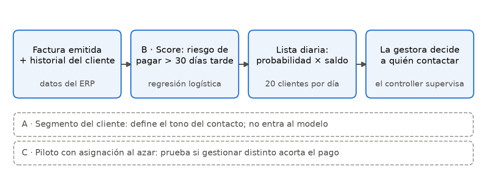

La solución tiene tres componentes. **B**, el score de pago tardío, es el modelo supervisado que
alimenta la lista. **A** agrupa a los clientes por cómo pagan y define el tono del contacto; no entra
como variable de B, porque se calcula con la misma información que la etiqueta. **C** estima cuánto
tarda de verdad cada segmento en pagar y diseña el piloto. Se descartaron, entre otros, evaluar el
desempeño por vendedor (riesgo ético de juzgar a trabajadores con datos no diseñados para eso) y la
proyección de recaudo (no cambia a quién se cobra) [R10 §4].

## 2. Datos

**Procedencia.** Sistema contable (ERP) de la compañía: 19.262 saldos (54 columnas) y 40.519
movimientos (44 columnas), de diciembre de 2019 a octubre de 2026, con 648 clientes. La compañía
autorizó su uso por escrito para este proyecto y los anonimizó de forma irreversible: nombres y
códigos reemplazados, montos multiplicados por un factor secreto por saldo y una columna de actividad
inventada. Fecha de corte y de acceso: 18/10/2026. No hay licencia pública; los datos no se
redistribuyen y quedan en `datos_crudos/`, excluida de Git [R11, ficha §1 y §2].

**El objetivo se construye.** La base no dice si una factura se pagó tarde. Se define `tardía` = 1
si la factura se pagó **más de 30 días después de vencer**, midiendo el atraso **hasta el último
recibo de caja**, no hasta que el saldo queda en cero. La diferencia importa: 1.795 facturas llegaron
a cero con una nota o un ajuste contable, no con dinero. Medir hasta el cero mezclaba «cliente que
paga tarde» con «contabilidad que cierra tarde» [R11, diagnóstico §1].

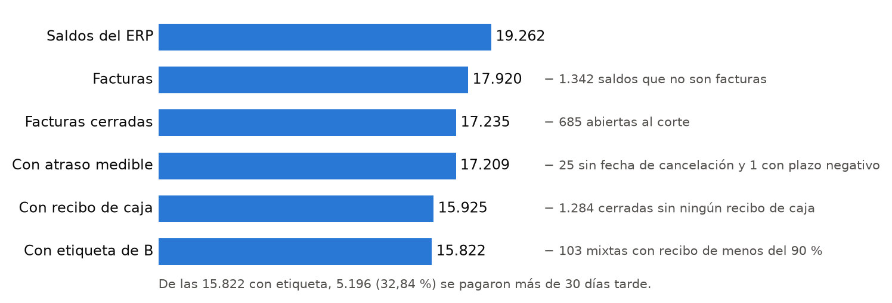

**Alternativas descartadas para la etiqueta.** Usar solo las facturas cerradas con recibo de caja
descartaba 511 facturas mixtas, en las que el cliente pagó casi todo (mediana del 99,62 %) y se sabe
cuándo; dejarlas todas y solo declararlo dejaba etiquetas falsas dentro. Se eligió medir las mixtas
hasta el último recibo y sacar las 1.284 cerradas sin ningún recibo. Las 103 mixtas cuyo recibo
cubre menos del 90 % también salen: el 90 % es un criterio del equipo, y con 80 % o 95 % la proporción
de tardías queda en 32,86 % y 32,84 % [R11, diagnóstico §1.5 y §1.6].

**Calidad.** No hay duplicados ni variantes de escritura en las categorías. Los faltantes están solo
en columnas posteriores a la emisión, que no entran al modelo; la peor, `dias_mora_actual` (96 %),
falta justo cuando el saldo está en cero. Se excluyen 245 saldos con vencimiento anterior a la
emisión, un error de registro [R11, ficha §4].

**Representatividad y sesgo.** El 98,3 % de los saldos es de personas jurídicas nacionales y la
**Empresa A concentra el 89 %**. Los resultados no representan bien a personas naturales, clientes
del exterior ni a las empresas B, C y D, y así se mide en §6 [R11, ficha §5]. **Límite que no se
puede corregir:** según el diccionario de datos, `fecha_vencimiento` refleja su valor al extraer, no
necesariamente el original. Si hubo prórrogas, el plazo aparece más largo y el atraso más corto, y
eso tocaría la etiqueta, el historial del cliente y el componente C. La base no guarda la fecha
original, así que no se puede contar cuántas veces pasó.

## 3. Preparación y diseño experimental

**Partición temporal antes de transformar.** El modelo se usa hacia adelante: con lo que se sabe
hoy, se ordenan las facturas de mañana. Por eso la partición es por fecha de emisión, con corte el
**1/07/2025**, y se agrupa por **trimestre**, no por cliente. Agrupar por cliente habría simulado
clientes nuevos, cuando la lista se usa con los mismos clientes, que se repiten mes a mes, y su
información principal es su propio historial [R12 §1].

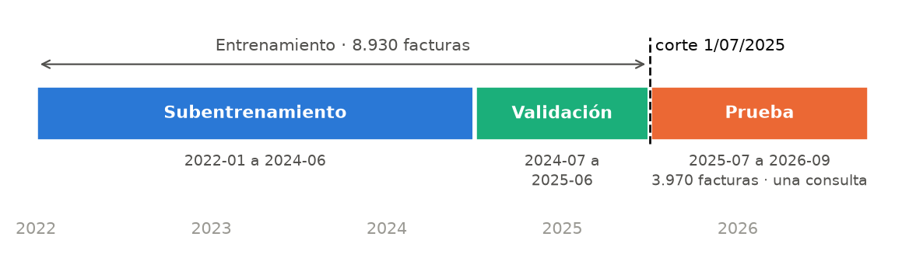

**Solo lo que se sabe al emitir.** Una factura entra a un conjunto solo si ya tuvo 30 días para
resolverse después de vencer, para no dejar en la prueba únicamente facturas pagadas a tiempo. Las
**11 predictoras** se conocen al emitir la factura: plazo, monto inicial, mes, unidad de negocio y
tipo de cliente; y, del historial del cliente **antes** de la emisión, atraso promedio, facturas
pagadas, saldo abierto, facturas abiertas y vencidas, y antigüedad. Una prueba automática recalcula el
historial fila por fila y da lo mismo en los 1.800 valores revisados [R12 §2].

| Columnas excluidas | Motivo |
|---|---|
| Fecha y tipo de cancelación, créditos, saldo y estado al corte, días de mora | Se conocen después de emitir: serían fuga. `dias_hasta_cancelacion` menos el plazo da exactamente el atraso en el 100 % de las cerradas |
| «% de facturas con más de 30 días» y el segmento de A | Son la etiqueta resumida por cliente |
| `total_debitos`, `codigo_cuenta` | Pueden cambiar después de la emisión |
| `nombre_vendedor`, `empresa` | Uso descartado: el vendedor evaluaría a personas; el grupo se trata como una sola empresa. Se usan solo para auditar |
| Identificadores de cliente | Para que el modelo no memorice al cliente |

**Todo dentro de un `Pipeline`.** Imputación, escala y codificación se ajustan solo con el
entrenamiento de cada pliegue. El **desbalance** (≈ 30 % de tardías) se trata en la comparación con
pesos de clase «balanceados», aplicados solo al entrenar [R14 §5]. La semilla es 2026 y las versiones
están en `requirements.txt`.

**La prueba se consultó una sola vez,** el 21/10/2026 a las 22:09, con el modelo, la lista y la
métrica ya fijados; nada se cambió después [evaluación B §3]. Las decisiones de modelado se tomaron
con validación cruzada dentro del entrenamiento: 5 pliegues de **ventana creciente** por trimestre
(2024-T2 a 2025-T2), en los que siempre se entrena con el pasado y se valida con el trimestre
siguiente. No se usa una CV estratificada al azar porque mezclaría facturas del futuro en el
entrenamiento.

## 4. Modelado

**Línea base y candidatos.** La línea base es un clasificador que predice siempre la proporción de
tardías. Se compararon seis familias bajo el mismo diseño: un árbol de decisión, regresión logística,
SVM con núcleo RBF, bosque aleatorio, gradient boosting y una red neuronal. Los dos ensambles se
ajustaron con 30 combinaciones de hiperparámetros cada uno, sobre todas las filas de entrenamiento:
la búsqueda los mejoró (0,697 → 0,719 y 0,700 → 0,720), pero dentro de la desviación [R13 §2].

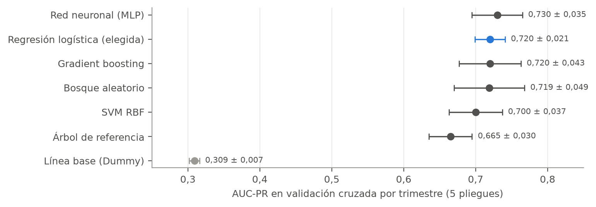

**Regla de elección, fijada antes de ver resultados.** Un modelo más complejo reemplaza a la
regresión logística solo si su mejora supera la variación de la validación. Ninguno lo logró. La red
neuronal tuvo la mejor media (0,730 frente a 0,720) y ganó en 4 de 5 pliegues, y su mejora superó la
variación entre semillas (0,002), pero **no la variación entre pliegues (0,035)**: según el trimestre
que se valide, la AUC-PR de un mismo modelo cambia casi cuatro veces más que la ventaja de la red.
Además, la red entrena unas 30 veces más lento, depende de la semilla y es más difícil de explicar a
cartera [R14 §6]. **El modelo final es la regresión logística.**

**Sesgo y varianza.** La red mostró el lado de la varianza: con dos capas (64 y 32 neuronas) la
AUC-PR bajó a 0,696 y se volvió más inestable; con 200 épocas dio menos que con 50. Más capacidad
llevaba a memorizar, y la mejor configuración fue la más regularizada (α = 1) [R14 §5]. El árbol de
referencia, de 6 niveles y 36 hojas, quedó a 0,011 de su desempeño en el subentrenamiento: no
sobreajusta, pero se queda corto frente a los modelos lineales y los ensambles [R12 §4].

**Qué usa el modelo.** Por permutación en datos no vistos, lo que pesa es el historial del cliente:
el atraso promedio (caída de 0,236 en AUC-PR al desordenarlo), las facturas vencidas (0,108) y las
facturas pagadas (0,066). Una columna de ruido de control da cero, como debe; la importancia por
impureza de un bosque la pone 6.ª, lo que muestra el sesgo de esa medida [R13 §4]. Ninguna
importancia indica causa.

**Componentes A y C.** La segmentación de clientes (A) usa K-means con k = 2 sobre siete variables
del perfil de pago hasta junio de 2025, con 158 clientes de entrenamiento. DBSCAN no encontró dos
grupos densos con ningún parámetro, y el agrupamiento jerárquico de Ward se reproduce peor [R16, R17]. Quedan dos segmentos: «paga a tiempo o
casi» y «paga tarde». Es la segmentación que mejor se reproduce con otra muestra (índice de Rand
ajustado mediano de 0,652, frente a 0,385 con k = 3), y anticipa el comportamiento posterior: en los
clientes de prueba, «paga tarde» se atrasa en el 80,2 % de sus facturas posteriores y el otro
segmento en el 34,3 % (diferencia de 45,9 puntos; p = 0,0006 por permutación de clientes, con solo
10 clientes en «paga tarde») [R17 §2]. C muestra que, con el mismo plazo pactado de 15 días, un
segmento paga en una mediana de 28 días y el otro en 72,5, y que dentro del mismo cliente el plazo
mueve poco el pago (0,29 días por día de plazo; IC 95 %: 0,07 a 0,61) [C §2 y §3].

## 5. Evaluación

**Por qué AUC-PR.** Con un cupo fijo, lo que importa es poner arriba las facturas que se van a
atrasar. El error que más cuesta es dejar fuera de la lista dinero que se va a atrasar (falso
negativo); llamar a quien igual iba a pagar (falso positivo) cuesta una llamada. La exactitud se
inflaría con el 70 % de facturas a tiempo; la AUC-PR mide el orden en la clase que importa.

**Calibración antes de la prueba.** La probabilidad se multiplica por el saldo, así que tiene que
estar calibrada. Con pesos balanceados la logística sobrestimaba todas las probabilidades. Calibrarla
con el método *sigmoid*, como estaba previsto, calibraba mal y bajaba la AUC-PR en validación. Se
eligió la misma logística sin pesos de clase, que por cómo se ajusta da probabilidades calibradas:
en validación, AUC-PR de 0,723 frente a 0,724 y Brier de 0,145 frente a 0,152 [evaluación B §1].

**Resultado técnico en la prueba.** En las 3.970 facturas de prueba (julio de 2025 a septiembre de
2026), la **AUC-PR es 0,744 (IC 95 % por bootstrap: 0,721 a 0,768)**, frente a 0,386 de la línea
base, y la AUC-ROC es 0,829 [evaluación B §3]. El orden se sostiene en un periodo que el modelo no
vio. La cifra no se compara directamente con la validación cruzada: la AUC-PR depende de la
proporción de tardías, y por eso la línea base también sube, de 0,309 a 0,386.

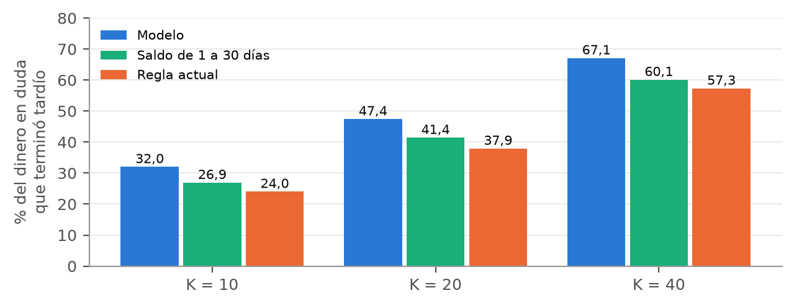

**Resultado de negocio: el backtest.** Cada día hábil del 1/07/2025 al 18/08/2026 se reconstruyó la
cartera con los movimientos anteriores a ese día y se armaron tres listas: la regla actual, una
segunda línea base (saldo vencido en facturas de 1 a 30 días de mora) y la del modelo. Con **K = 20,
el modelo captura el 47,4 %** del dinero en duda que terminó tardío, frente al **37,9 % de la regla
actual** y al 41,4 % de la segunda línea base. Le gana a la regla actual en **254 de 296 días** y a la
segunda línea base en 200; la mediana diaria es 45,8 % frente a 38,0 % y 42,4 %. Con K = 10 y K = 40
el orden es el mismo [evaluación B §3].

**Tabla complementaria, siempre secundaria.** Contando todo el dinero tardío, también el que ya
estaba decidido, la regla actual capta más (46,5 % frente a 43,7 %), porque el 44,7 % del saldo de su
lista ya era dinero tardío. Es lo esperado: la regla mira lo que ya se atrasó y el modelo anticipa lo
que se va a atrasar. Por eso la métrica principal solo cuenta el dinero todavía en duda.

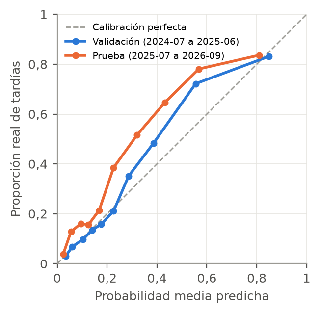

**La probabilidad queda corta en la prueba.** En la prueba hay más tardías (38,6 %) que en el
entrenamiento (≈ 30 %), y la calibración se desplaza: el orden sigue siendo bueno, pero la
probabilidad no se puede leer al pie de la letra [evaluación B §3].

**Umbral recomendado.** El umbral no es un corte de probabilidad sino el **cupo operativo de 20
clientes por día**, que es la capacidad real de las gestoras. Como el orden se sostiene aunque la
probabilidad se desplace, la lista sigue siendo útil con el cupo; un corte fijo de probabilidad, en
cambio, marcaría muchas menos facturas de las debidas en un periodo con más tardías.

## 6. Decisión, límites y gobernanza

**Recomendación: adoptar la lista con condiciones.** Usarla para ordenar el trabajo de las gestoras,
no para prometer ahorros. Reentrenar ya con la historia reciente, porque la proporción de tardías salió
del rango de referencia. Vigilar cuatro métricas. Y validar el beneficio con un piloto antes de
reportar un efecto.

**Lo que se midió y lo que no.** El backtest compara qué dinero estaba en cada lista; **no mide si
llamar a esos clientes acorta el atraso**. Que el modelo ordene mejor es una correlación medida; que
gestionar según la lista cobre antes es una hipótesis causal. Para probarla, C diseña un piloto en el
que los clientes activos de cada segmento se asignan **al azar** a una gestión nueva o a la actual. Con
todos los clientes activos, el piloto solo detectaría diferencias de 13 a 14 días en «paga a tiempo o
casi» y de 25 a 27 en «paga tarde» [C §5]. Tampoco hay una decisión secuencial que justifique un
agente de aprendizaje por refuerzo: los datos no registran qué gestión se hizo a cada cliente, así que
no hay recompensa por acción que observar [R18 §4].

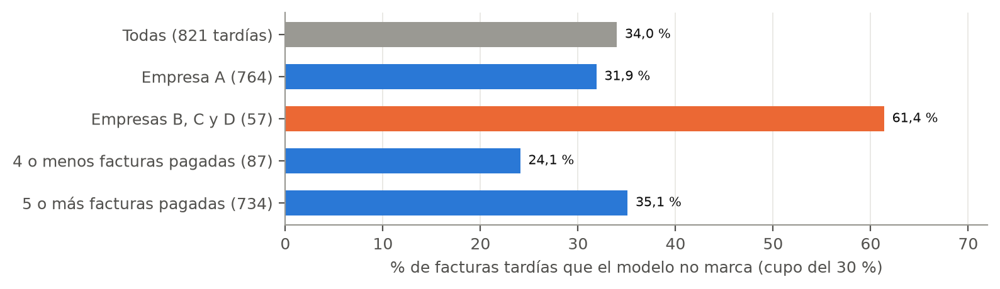

**A quién podría perjudicar.** El modelo deja pasar el **61,4 % de las facturas tardías de las
empresas B, C y D**, frente al 31,9 % de la Empresa A: aprende sobre todo de la A, que tiene el 89 %
de los datos, y tratar el grupo como una sola empresa no lo corrige. Su cartera tardía recibiría menos
seguimiento. La cifra se apoya en solo 57 facturas tardías y viene de la validación, no de la prueba
[R14 §7]. En el otro sentido, el modelo marca el 52,3 % de las facturas de clientes con poca historia,
aunque solo el 31 % es tardía: podrían recibir un cobro más insistente sin merecerlo [R13 §5].

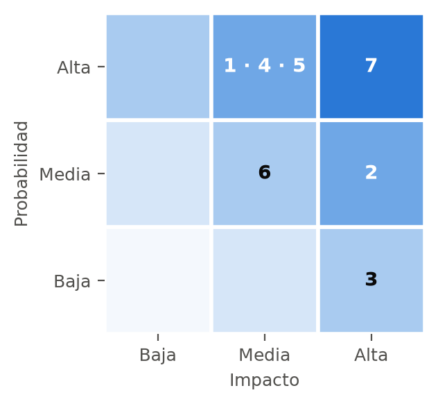

| # | Riesgo | Mitigación |
|---|---|---|
| 1 | Deriva del nivel de atraso: la probabilidad queda corta | Usar solo el orden; reentrenar con la historia reciente |
| 2 | `fecha_vencimiento` puede no ser la original | Preguntar a cartera si prorroga y si guarda la original; si no, declararlo |
| 3 | Fuga de datos confidenciales | Datos fuera de Git; aplicación privada, solo durante la sustentación |
| 4 | Peor cobertura en las empresas B, C y D | Reportar por empresa; no generalizar; revisar un cupo por empresa |
| 5 | Cobro insistente a clientes con poca historia | La gestora decide; quedan sin segmento |
| 6 | Profecía autocumplida: los no priorizados se deterioran | Correo semanal para todos; vigilar a los no priorizados |
| 7 | Beneficio no demostrado | No prometer ahorros; piloto al azar antes de reportar efecto |

**Plan de seguimiento** [R18 §3]. Los umbrales son un criterio del equipo, no salen de los datos.

| Métrica | Referencia | Umbral | Frecuencia |
|---|---|---|---|
| Proporción de facturas tardías | 31–34 % anual; 38,6 % en la prueba | Fuera del rango un trimestre: revisar | Mensual |
| Monto capturado con K = 20 frente a la regla actual | 47,4 % frente a 37,9 % | Ventaja < 5 puntos: reentrenar; ≤ 0 dos trimestres: retirar | Trimestral |
| AUC-PR en facturas nuevas | 0,744 (0,721 a 0,768) | Por debajo de 0,721: reentrenar | Trimestral |
| Falsos negativos B, C y D frente a A | 61 % frente a 32 % | Brecha mayor que 29 puntos: revisar el cupo | Trimestral |

**Condiciones que invalidarían la recomendación:** que el modelo deje de superar a la regla actual
dos trimestres seguidos, o que el piloto muestre que gestionar distinto no cambia el pago. Como una
factura solo tiene desenlace 30 días después de vencer, un deterioro se detecta con al menos un mes
de retraso. **La primera métrica ya está fuera del rango**, así que según este plan el modelo debe
reentrenarse antes de usarse.

## 7. Roles y trabajo en equipo

Los tres trabajamos cada fase juntos, sin repartir el proyecto por perfil. Cada decisión quedó
registrada con quién la tomó, cómo, qué alternativas se descartaron y quién la defiende.

| Integrante y rol | Qué aportó y qué decisiones defiende |
|---|---|
| **Claudia Naranjo**, Jefa | La definición del objetivo: atraso hasta el último recibo de caja, desenlace conocido y mixtas con poco recibo. La partición por bloques de tiempo, la segunda línea base y la métrica del backtest. El número de segmentos de A |
| **Yery Pedraza**, Líder | La poda del árbol de referencia, la calibración sin pesos de clase, el diseño y la adopción con condiciones de la segmentación, el replanteamiento de C y su piloto, y la decisión de que no hay un problema secuencial |
| **Nicolás Ruiz**, Crack | El corte de la partición y las 11 predictoras, el tratamiento del grupo como una sola empresa, la búsqueda de hiperparámetros, el diseño de la comparación de modelos y de la red, y el diseño de la calibración y del backtest con una sola consulta a la prueba |

Por consenso de los tres se decidieron el enfoque de intraemprendimiento y los gráficos de este
informe. Las demás las tomó cada rol dentro de su ámbito.

## Anexos y referencias

Los anexos completos son los archivos `.md` del zip: `ficha_datos.md` (ficha de datos),
`declaracion_IA.md` (uso de IA), `anexo_A_enfoque.md` (enfoque) y `anexo_B_datos_reales.md` (datos
reales).

**Gráficos de validación.** Se calcularon con `scripts/figuras_anexo.py` sobre los datos de la
compañía, **sin la prueba**: solo facturas emitidas antes del 1/07/2025 y desenlaces conocidos a esa
fecha. Las cifras de control coinciden con los cuadernos (AUC-PR de 0,723 en validación; 57,1 %,
50,4 % y 44,3 % en el ensayo del backtest; medianas de 28 y 72,5 días).

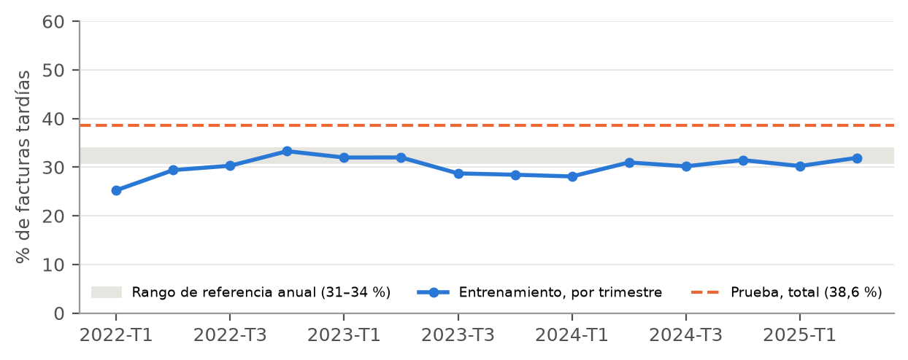

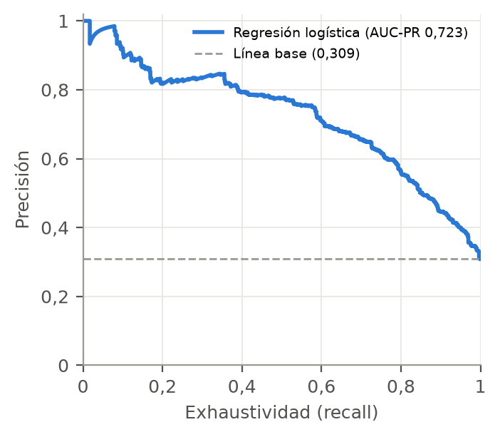

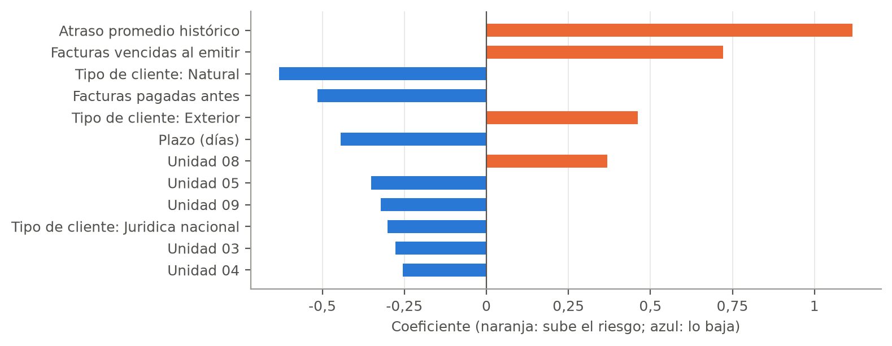

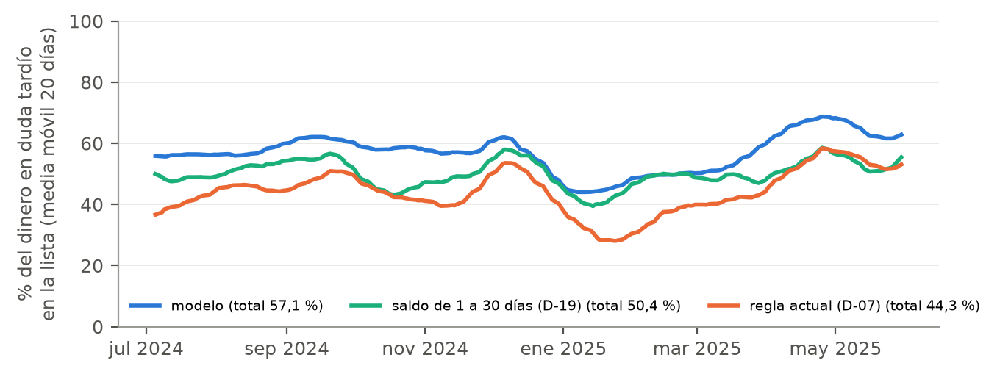

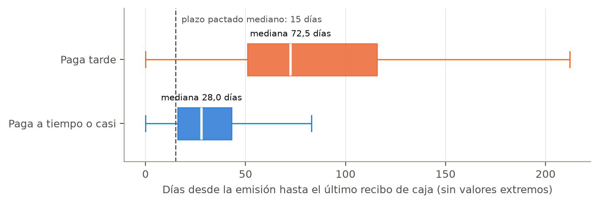

**Referencias (APA 7)**

Compañía anonimizada. (2026). *Cartera de cuentas por cobrar: saldos y movimientos, 2019–2026*
[Datos no publicados, anonimizados; uso autorizado para este proyecto].

Pedregosa, F., Varoquaux, G., Gramfort, A., Michel, V., Thirion, B., Grisel, O., Blondel, M.,
Prettenhofer, P., Weiss, R., Dubourg, V., Vanderplas, J., Passos, A., Cournapeau, D., Brucher, M.,
Perrot, M., & Duchesnay, É. (2011). Scikit-learn: Machine learning in Python. *Journal of Machine
Learning Research, 12*, 2825–2830.
