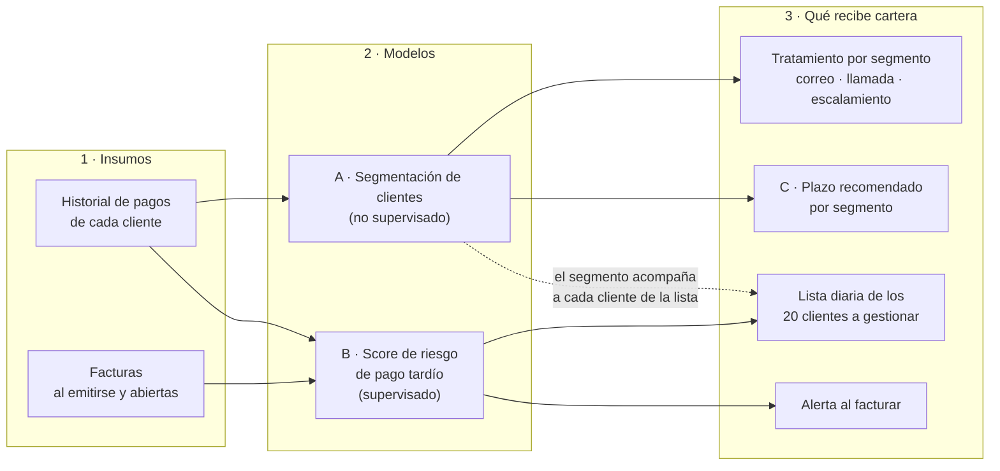

# R10 · Planteamiento del problema de negocio y de la solución

> **Proyecto Final Integrador · Machine Learning I (IMPN0004) · Universidad EAN**
> Fase CRISP-DM: **Comprensión del negocio** · Reto acumulativo: **R10 (anteproyecto)**
> Integrantes: **Claudia Naranjo, Yery Pedraza y Nicolás Ruiz**
> Última actualización: 2026-10-21

Este documento fija el problema, la decisión que se quiere apoyar, la solución elegida y las reglas
de juego del proyecto: definiciones, métricas, alcance y riesgos. Todo lo que se construya después
debe poder rastrearse hasta aquí.

**Cómo leer las cifras.** Todas las cifras salen del cuaderno
[`viabilidad_R10.ipynb`](viabilidad_R10.ipynb),
que las calcula paso a paso. Junto a cada cifra se explica qué mide y cómo se obtuvo, y se indica la
sección del cuaderno donde está el cálculo (por ejemplo, *[Cuaderno §2]*).

**Enfoque del proyecto: intraemprendimiento.** El proyecto propone una mejora para el área de
cartera de la propia compañía.

- **Propuesta de valor:** una lista diaria que les dice a las dos gestoras a qué 20 clientes
  contactar primero, ordenada por el dinero con mayor riesgo de pagarse con más de 30 días de
  atraso. Así cobran antes con la misma capacidad del equipo.
- **Usuarias:** las gestoras de cartera; el controller supervisa (§2).
- **Hipótesis de mejora:** §2. **Impacto estimado y sus supuestos:** §3 y §8 (cada día menos de
  recaudo libera ≈ $65 M).
- **Ruta de validación:** el backtest (§8) y un piloto con grupo de comparación (§5, C).

---

## 1. Contexto

La compañía es un grupo empresarial colombiano de servicios: cuatro empresas y once unidades de
negocio (líneas de servicio). Vende a crédito, sobre todo a empresas (personas jurídicas
nacionales), y registra sus cuentas por cobrar, la **cartera**, en su sistema contable (ERP).

**Proceso actual de cobro**

| Elemento | Cómo funciona hoy |
|---|---|
| Equipo | 2 gestoras de cartera y 1 controller, que no gestiona cobros pero supervisa que se hagan |
| Herramienta | Un cuadro de mando que se actualiza a diario. Por cliente muestra cuánto debe, para cuándo debe pagarlo y, si ya venció, cuántos días lleva de mora |
| Gestión automática | Un correo programado que se envía cada semana a cada cliente con saldo pendiente |
| Gestión humana | Las gestoras hacen seguimiento a ese correo y contactan directamente a los clientes, eligiéndolos visualmente en el tablero |
| Criterio para elegir a quién cobrar | **Saldo más alto y vencimiento más próximo** |
| Capacidad de gestión personalizada | El área estima unos **20 clientes por día** entre las dos gestoras (llamada, registro y seguimiento) |

El criterio actual es **reactivo y no distingue comportamientos**. Trata igual a un cliente que
siempre paga unos días tarde pero termina pagando, que a uno cuyo comportamiento se está
deteriorando y que probablemente se atrasará mucho más.

## 2. Problema y decisión

**Problema de negocio.** La compañía recibe el dinero de sus facturas, en promedio, **unos 22 días
después de lo pactado** (§3), y el equipo solo puede dar seguimiento personalizado a unos 20 de los
aproximadamente 135 clientes que tienen facturas vencidas en un día típico. Hoy esos 20 se eligen por
tamaño del saldo y cercanía del vencimiento, sin tener en cuenta qué tan probable es que cada cliente
se atrase.

**Decisión que se apoya.**

| Pregunta | Respuesta |
|---|---|
| ¿Qué se decide? | A qué clientes y facturas dedicar el seguimiento humano **hoy**, y con qué tratamiento |
| ¿Quién decide? | Las gestoras de cartera; el controller supervisa |
| ¿Con qué frecuencia? | Todos los días hábiles |
| ¿A quién afecta? | A los clientes (cuánta presión de cobro reciben), a las gestoras (en qué invierten su tiempo) y a finanzas (cuándo entra el dinero a caja) |
| ¿Qué cambia con la solución? | La lista diaria deja de ordenarse por "saldo y vencimiento" y pasa a ordenarse por "riesgo de pago tardío × saldo", con un tratamiento distinto según el tipo de cliente |

**Hipótesis de mejora.** Con la misma capacidad diaria (20 clientes), priorizar según el riesgo de
pago tardío y el tipo de cliente permite recuperar más dinero, o recuperarlo antes, que la regla
actual, y con ello reducir los días que tarda la empresa en cobrar.

## 3. Dimensión del problema: lo que muestran los datos

### 3.1 Antes de las cifras: tres aclaraciones

1. **¿Qué es un saldo y qué es una factura?** Los datos tienen una fila por **saldo**, que es el
   registro contable de una cuenta por cobrar. La mayoría de los saldos nacen de una factura, pero
   algunos nacen de notas crédito, ajustes contables o saldos iniciales. En este proyecto,
   **factura** es un saldo cuyo documento de origen es una factura electrónica (código `FEV` o
   `FVE`), tal como la define el diccionario de datos (columna `es_deuda_facturada`). Son 17.920 de
   los 19.262 saldos *[Cuaderno §1]*. Se analizan solo las facturas porque son la deuda que nace de
   vender, que es la que cartera cobra.
2. **¿Por qué los montos son "aproximados (±15 %)"?** Para anonimizar los datos, cada saldo se
   multiplicó por un factor secreto entre 0,85 y 0,98 o entre 1,02 y 1,15 (en promedio, 1). Por eso
   un monto individual difiere del real entre un 2 % y un 15 %. Al sumar miles de saldos, esas diferencias se compensan
   entre sí, así que los totales sí son una buena aproximación. Las proporciones dentro de un mismo
   saldo, como el porcentaje pagado, son exactas. Los montos están en pesos colombianos (COP); "M" =
   millones.
3. **¿Qué significa "ponderado por monto"?** Es un promedio en el que cada factura pesa según su
   valor: una factura de $100 M cuenta cien veces más que una de $1 M. Se usa porque para la caja
   importa dónde está el dinero, no cuántos documentos hay.

### 3.2 Cifras principales

| Indicador | Valor | Qué mide y cómo se obtuvo |
|---|---|---|
| Facturado en 2025 | ≈ $23.800 M | Suma del valor de las 3.344 facturas emitidas en 2025, el último año completo *[Cuaderno §2]* |
| Facturado por día | ≈ **$65 M** | Facturado 2025 ÷ 365 días *[Cuaderno §2]* |
| Plazo pactado, ponderado por monto | 21 días | Promedio, ponderado por monto, de los días entre la emisión y el vencimiento de las facturas de 2025 *[Cuaderno §2]* |
| Días reales hasta cancelar, ponderado por monto | **43 días** | Promedio, ponderado por monto, de los días entre la emisión y el momento en que el saldo quedó en cero, para las facturas de 2025 ya canceladas *[Cuaderno §2]* |
| Brecha | **≈ 22 días** | 43 − 21: cuántos días después de lo pactado entra el dinero |
| Facturas pagadas después del vencimiento | 77 % | De las 17.209 facturas ya cerradas (2019–2026), el porcentaje cuyo saldo quedó en cero después de la fecha de vencimiento *[Cuaderno §3]* |
| Facturas pagadas más de 30 días después del vencimiento | 34 % de las facturas (30 % del monto) | Igual que la anterior, pero con más de 30 días de atraso *[Cuaderno §3]* |
| Saldos cerrados | 96 % | Porcentaje de los 19.262 saldos que hoy están en cero *[Cuaderno §5]* |
| Cartera pendiente a la fecha de corte | ≈ $3.380 M en 207 clientes | Suma de los saldos de las facturas que no estaban pagadas el 2026-10-18 *[Cuaderno §4]* |
| Cartera con más de 90 días de mora | ≈ $540 M | Parte de la cartera pendiente cuyo vencimiento pasó hace más de 90 días *[Cuaderno §4]* |

### 3.3 La carga diaria del equipo de cartera

Los datos son una foto al día de corte, pero sus fechas permiten **reconstruir cómo estaba la cartera
cualquier día del pasado**. Para cada uno de los 261 días hábiles de 2025 se contó qué facturas
estaban abiertas (emitidas y aún no pagadas) y cuáles vencidas (abiertas y con el vencimiento ya
pasado). La tabla muestra la **mediana**, es decir, el valor de un día típico *[Cuaderno §6]*.

| En un día típico de 2025 había… | Cantidad |
|---|---|
| Facturas abiertas | 464 |
| Clientes con alguna factura abierta | 183 |
| **Clientes con alguna factura vencida** | **135** |
| Facturas con más de 30 días de mora | 171 |
| Facturas nuevas emitidas (promedio por día hábil) | ~13 |
| Facturas pagadas con recibo de caja (promedio por día hábil) | ~12 |

Con capacidad para unos 20 clientes por día, el equipo alcanza a gestionar de forma personalizada a
**cerca del 15 %** de los clientes vencidos de cada día (20 de 135). Elegir bien a esos 20 es la
decisión que se quiere mejorar.

### 3.4 Lectura

- **El problema no es la cartera incobrable.** El 96 % de los saldos termina en cero y la cartera con
  más de 90 días de mora (≈ $540 M) es pequeña frente a lo que se factura en un año (≈ $23.800 M).
- **El problema es la velocidad con que se cobra.** La empresa recibe el dinero unos 22 días después
  de lo pactado.
- **¿Por qué "cada día de recaudo vale unos $65 M"?** Lo que una empresa tiene por cobrar en un
  momento dado es, aproximadamente, lo que factura en un día multiplicado por los días que tarda en
  cobrar. Esta es la idea del indicador financiero **DSO** (*days sales outstanding*, o días de
  cartera). Si la compañía cobrara en promedio un día antes, tendría por cobrar más o menos un día de
  facturación menos, es decir, **unos $65 M más disponibles en caja** (capital de trabajo liberado).
  Cobrar 5 días antes equivaldría a ≈ $325 M *[Cuaderno §2]*.

### 3.5 Primer indicio de que modelar es viable

Antes de prometer un modelo, se probó si un clasificador simple ordena las facturas tardías mejor
que una línea base que no aprende nada *[Cuaderno §9]*:

- **Muestra:** facturas de 2022 a 2024 con desenlace conocido. La partición es por fecha y se hace
  antes de transformar: se entrena con 2022–2023 y se valida con 2024 (2.820 facturas, 30,2 %
  tardías). Las de 2025 y 2026 no se tocan, porque quedan para la prueba final.
- **Variables:** solo las que se conocen al emitir la factura (plazo, monto inicial, mes, empresa y
  unidad de negocio). Todavía no se usa el historial del cliente.

| Modelo | AUC-PR en validación |
|---|---|
| Línea base (predice siempre la proporción de tardías) | 0,302 |
| Naive Bayes gaussiano | 0,321 |
| KNN (k = 25) | **0,351** |

La AUC-PR mide qué tan bien el modelo pone las facturas tardías por encima de las demás; a
diferencia de la exactitud, no se infla cuando la clase de interés es minoritaria. Los dos modelos
superan a la línea base, pero por poco: sin el historial del cliente, la información de la factura
sola dice poco. Ese historial, calculado sin fuga (§7.1), es lo que debería ampliar la diferencia.

## 4. Enfoques evaluados

Se evaluaron diez formas de usar estos datos para ayudar a cartera. Criterios de clasificación:

- **Impacto Alto:** cambia directamente la decisión diaria de a quién cobrar y, por tanto, la
  velocidad de recaudo (≈ $65 M por día). **Medio:** mejora el control o la planeación sin cambiar
  directamente a quién se cobra. **Bajo:** aporta información, pero no una decisión.
- **Viabilidad Alta:** los datos tienen todo lo necesario. **Media:** requiere reconstrucciones o
  supuestos importantes. **Baja:** faltan datos esenciales.

| # | Enfoque | Paradigma | Impacto | Viabilidad | Decisión | Justificación |
|---|---|---|---|---|---|---|
| 1 | Segmentación de clientes por comportamiento de pago | No supervisado (agrupamiento) | Alto | Alta | **Elegido** | **Por qué este enfoque:** permite dar un tratamiento distinto a cada tipo de cliente en vez de tratarlos a todos igual. **Por qué no supervisado:** no existe una etiqueta de "tipo de cliente"; se busca descubrir grupos naturales a partir de cómo pagan. **Por qué alto impacto:** define qué clientes necesitan solo el correo y cuáles atención humana, que es el recurso escaso. **Por qué viable:** hay historia de pagos por cliente. 329 clientes tienen 5 o más facturas pagadas, suficientes para describir su comportamiento, y concentran el 96,7 % de todas las facturas pagadas *[Cuaderno §3]*. |
| 2 | Score de priorización de la cartera abierta | Supervisado (clasificación) | Alto | Alta | **Elegido** (mismo modelo que el 3) | **Por qué este enfoque:** responde directamente a la pregunta diaria, "¿a quién llamo hoy?". **Por qué supervisado:** el desenlace histórico (si la factura se pagó o no más de 30 días tarde) es conocido, así que sirve como etiqueta. **Por qué alto impacto:** reordena el uso de los 20 cupos diarios. **Por qué viable:** hay unas 17.900 facturas con desenlace conocido, y la regla actual existe y sirve de comparación. |
| 3 | Alerta de pago tardío al facturar | Supervisado (clasificación) | Alto | Alta | **Elegido** (mismo modelo que el 2) | **Por qué este enfoque:** permite cobrar de forma preventiva, antes del vencimiento, y no solo reaccionar a la mora. **Por qué supervisado:** usa la misma etiqueta que el enfoque 2. **Por qué alto impacto:** actúa antes de que el atraso ocurra. **Por qué viable:** se predice con información disponible al emitir la factura más el historial del cliente hasta ese día. Al ser el mismo modelo que el 2, no exige trabajo adicional. |
| 4 | Proyección de recaudo y flujo de caja | Supervisado (regresión) | Medio | Media | Fuera de alcance | **Por qué no:** apoya la planeación de tesorería, no la decisión de a quién cobrar. Además, exige estimar fechas de pago exactas y sumar pagos parciales, más complejo que clasificar "tarde / no tarde", y no cabe en el plazo del proyecto. |
| 5 | Alerta temprana de deterioro del cliente | Series de tiempo / detección de cambios | Medio | Media | Fuera de alcance | **Por qué no:** buena idea, pero requiere reconstruir el comportamiento de cada cliente mes a mes, y muchos clientes tienen pocas facturas. Parte de su valor queda cubierto por el enfoque 2, que usa el historial reciente del cliente. |
| 6 | Plazo de pago recomendado por perfil | Segmentación + reglas | Medio | Media | **Elegido**, como recomendación de política | **Por qué este enfoque:** el plazo es una palanca que la empresa controla. **Por qué no es un modelo:** los datos solo muestran asociaciones entre plazo y atraso, no efectos causales (§5, componente C). Por eso se presenta como una política sugerida por segmento, a validar con un piloto. **Por qué viable:** sale directamente de los segmentos del enfoque 1. |
| 7 | Detección de anomalías en cierres y registros | No supervisado (anomalías) | Medio | Alta | Fuera de alcance | **Por qué no:** sirve a control interno o auditoría (por ejemplo, el 10,5 % de las facturas cerradas se cerró con notas o ajustes y no con un pago), no a la gestión de cobro. Es un buen proyecto futuro. |
| 8 | Tipología de trayectorias de pago | No supervisado (agrupamiento de secuencias) | Bajo | Alta | Fuera de alcance | **Por qué no:** describe cómo se suelen cerrar las facturas (pago único, abonos, notas), pero no cambia a quién se cobra. Se usa solo como insumo descriptivo de la segmentación. |
| 9 | Desempeño de cobro por vendedor o unidad | Análisis descriptivo ajustado | Medio | Media | Descartado | **Por qué no:** evaluaría a personas con datos que no fueron diseñados para eso (el vendedor registrado refleja el catálogo actual, no necesariamente el histórico). Riesgo ético de perjudicar a trabajadores con conclusiones injustas. |
| 10 | Optimización de la agenda de cobro | Aprendizaje por refuerzo | Alto en teoría | Baja | Descartado | **Por qué no:** necesita saber qué acción de cobro se tomó con cada cliente (llamada, correo, visita) y qué pasó después. Esos registros **no existen** en los datos, así que el modelo no tendría de qué aprender. |

## 5. Solución propuesta

La solución combina **dos modelos y una capa de recomendaciones**. No reemplaza el cuadro de mando que
cartera ya usa: le agrega una vista con la lista priorizada y el tipo de cada cliente.

**Cómo leer el diagrama**

| Componente | Pregunta que responde | Usa | Entrega | Quién lo usa y cuándo |
|---|---|---|---|---|
| **A · Segmentación** | ¿Qué tipos de pagadores tenemos? | El historial de pagos de cada cliente | Un segmento por cliente, con un nombre de negocio | Cartera, para decidir el tratamiento; se actualiza periódicamente |
| **B · Score, uso 1: lista diaria** | ¿A cuáles 20 clientes gestiono hoy? | Facturas abiertas + historial del cliente | Clientes ordenados por riesgo × saldo | Gestoras, cada mañana |
| **B · Score, uso 2: alerta al facturar** | ¿Qué factura nueva tiene alta probabilidad de pagarse muy tarde? | Datos de la factura al emitirse + historial del cliente | Facturas marcadas como de alto riesgo | Gestoras, para un cobro preventivo antes del vencimiento |
| **C · Plazo por segmento** | ¿Qué plazo conviene ofrecer a cada tipo de cliente? | Los segmentos de A | Una política sugerida para probar | Controller y dirección financiera |

### A · Segmentación de clientes (enfoque 1)

Agrupa a los clientes según **cómo pagan**:
- qué tan tarde suelen pagar (atraso típico) y qué tan variable es ese atraso;
- qué proporción de sus facturas se pagó con más de 30 días de atraso;
- cuánto y con qué frecuencia se les factura;
- si suelen pagar con varios abonos parciales;
- con qué frecuencia sus facturas se cierran con notas o ajustes en vez de pagos.

A cada segmento se le da un nombre comprensible y un tratamiento. Ejemplo ilustrativo: "le basta el
correo semanal", "requiere llamada", "requiere escalamiento".

### B · Score de riesgo de pago tardío (enfoques 2 y 3)

Un solo modelo, entrenado con facturas cuyo desenlace ya se conoce, estima la **probabilidad de que una
factura se pague más de 30 días después de su vencimiento**. Tiene dos usos:

1. **Lista diaria:** a cada cliente con facturas vencidas se le asigna una prioridad igual a la suma,
   sobre sus facturas, de *probabilidad de pago tardío × saldo*. Se gestionan los 20 primeros.
   Combinar las dos cosas evita perseguir facturas muy riesgosas pero de valor insignificante, y
   también facturas grandes que de todos modos se van a pagar a tiempo.
2. **Alerta al facturar:** las facturas nuevas con probabilidad alta se marcan para contactar al
   cliente antes del vencimiento.

> **Nota: ¿por qué 30 días?** La compañía reporta su cartera por **edades de mora**: 0 a 30, 31 a 60,
> 61 a 90 y más de 90 días después del vencimiento. Para el área de cartera, una factura en el tramo
> de 0 a 30 días está dentro de lo habitual; **a partir de 30 días se considera cartera en mora que
> exige gestión**, y así lo confirma el controller. Los datos son coherentes con esa práctica:
> pagar algo tarde es lo normal (77 % de las facturas cerradas se pagó después del vencimiento),
> mientras que pasar de 30 días le ocurre a una de cada tres facturas (34 %) *[Cuaderno §3]*.

### C · Recomendación de plazo por segmento (enfoque 6)

Es una **política sugerida, no un modelo**: qué plazo y qué condiciones conviene ofrecer a cada
segmento. Se presenta como **hipótesis a validar**.

> **Nota: ¿por qué un modelo de plazos mostraría correlación y no causalidad?** En los datos, el
> plazo de cada factura no se asignó al azar: lo negoció la empresa con cada cliente, y seguramente
> dio plazos más largos a clientes grandes, de confianza o con más poder de negociación. Si un modelo
> encontrara que "los clientes con 30 días de plazo se atrasan menos", no podríamos saber si es por
> el plazo o porque **esos clientes ya eran mejores pagadores** y por eso recibieron más plazo. Esa
> variable oculta (la calidad del cliente) influye a la vez en el plazo y en el atraso, y genera una
> asociación que no es un efecto. Por eso, cambiarle el plazo a un cliente no garantiza que cambie
> su comportamiento. Además, casi todas las facturas tienen el mismo plazo de 15 días, así que hay
> muy poca variación de la cual aprender. La única forma de medir el efecto real es un **piloto**:
> cambiar el plazo a un grupo de clientes de un segmento, dejar otro grupo similar igual, y comparar.

**Paradigma: híbrido.** El aprendizaje no supervisado (A) se usa para entender la estructura de la
cartera: no hay una etiqueta de "tipo de cliente" y se busca descubrirla. El supervisado (B) se usa
para la decisión diaria: el desenlace histórico es conocido, lo que permite comparar contra una
línea base, fijar un umbral de decisión y medir el costo de cada tipo de error.

## 6. Definiciones

| Concepto | Definición | Aclaración / por qué importa |
|---|---|---|
| Factura | Saldo cuyo documento de origen es una factura electrónica (`FEV`/`FVE`; columna `es_deuda_facturada = True`) | Excluye saldos nacidos de notas, ajustes o saldos iniciales, que no son ventas |
| Vencimiento | Fecha límite de pago de la factura (`fecha_vencimiento`) | El plazo es la diferencia entre el vencimiento y la emisión |
| Atraso de una factura | Días entre el vencimiento y la fecha en que el saldo quedó en cero (`fecha_cancelacion_registrada − fecha_vencimiento`) | Se mide hasta el pago **total**, no hasta el primer abono, porque a la caja le importa cuándo entra todo el dinero. Negativo = pago anticipado |
| **Pago tardío (variable objetivo de B)** | Vale 1 si el atraso es **mayor que 30 días** y 0 si no | Criterio de la compañía (ver nota en §5) |
| Desenlace conocido | Se sabe si la factura fue o no un pago tardío. Es el caso de las facturas ya pagadas y de las que, aún abiertas, ya llevan más de 30 días vencidas (ya son tardías aunque no se hayan pagado) | Solo estas facturas sirven para entrenar y evaluar. Una factura vencida hace 10 días todavía puede pagarse a tiempo o no: su desenlace es desconocido y se excluye |
| Facturas excluidas de B | Las de plazo negativo, que son un error de registro (vencimiento anterior a la emisión; 245 saldos *[Cuaderno §7]*), y las de desenlace desconocido | Evita aprender de datos erróneos o incompletos |
| Unidad de análisis de A | El **cliente** (`nit_cliente`), con al menos 5 facturas pagadas: 329 clientes *[Cuaderno §3]* | Con menos de 5 no hay suficiente historia para describir cómo paga; esos clientes quedan en un grupo "sin historia suficiente" |
| Unidad de análisis de B | La **factura** (`id_saldo`) | El riesgo se estima por factura y luego se suma por cliente para armar la lista |
| **K = 20 clientes por día** | Número de clientes a los que las dos gestoras pueden dar seguimiento personalizado en un día de trabajo (llamada, registro y seguimiento) | Es la capacidad real del equipo. Define el tamaño de la lista diaria y es el **umbral de decisión** del modelo: no se elige una probabilidad de corte arbitraria, sino a los 20 más prioritarios. También se reporta qué pasaría con 10 y con 40 |
| Regla actual | Ordenar a los clientes con facturas vencidas por saldo vencido, de mayor a menor, y en caso de empate por el vencimiento más próximo | Es la **línea base**: lo que la solución tiene que superar |

## 7. Diseño experimental: reglas para no engañarnos

Un modelo puede parecer excelente en las pruebas y fallar en la vida real si durante su construcción
"ve" información que no tendría al momento de usarse. Eso se llama **fuga de información**. Estas
reglas la evitan:

1. **Solo información disponible al momento de predecir.** El diccionario de datos del proyecto
   (`datos_crudos/diccionario-datos.md`, confidencial y fuera de Git) marca con **(P)** las columnas que solo se conocen *después* de
   emitir la factura o que describen su estado a la fecha de corte; por ejemplo, cuánto se ha pagado o
   los días de mora actuales. Esas columnas **no se usan** para predecir, porque cuando se emite una
   factura todavía no existen. El historial de cada cliente (por ejemplo, su atraso promedio) se
   calcula **solo con facturas pagadas antes del día de la factura que se evalúa**.
2. **Partición temporal.** El modelo se entrena con las facturas más antiguas y se prueba con las más
   recientes cuyo desenlace ya se conoce. Así se simula su uso real: aprender del pasado para predecir
   el futuro. Una partición al azar mezclaría facturas futuras en el entrenamiento y daría resultados
   demasiado optimistas. Por la misma razón, en la validación cruzada los bloques respetan el orden
   del tiempo.
3. **Periodo de estudio: desde 2022.** En 2020 y 2021, el **43 %** de las facturas pagadas se pagó con
   más de 30 días de atraso, frente a entre el **31 % y el 34 %** de cada año desde 2022 (2026 va en
31 %, aunque el año aún no termina) *[Cuaderno §3]*. Ese cambio,
   probablemente asociado a la pandemia, muestra que en esos años los clientes se comportaron distinto.
   Entrenar con ellos enseñaría al modelo un patrón que ya no se observa.
4. **Las transformaciones se ajustan solo con el conjunto de entrenamiento.** Algunos pasos de
   preparación "aprenden" de los datos: por ejemplo, la estandarización calcula la media y la
   desviación de cada variable, y la imputación calcula la mediana para llenar vacíos. Si esos valores
   se calculan con todos los datos, información del conjunto de prueba se filtra al modelo y su
   desempeño parece mejor de lo que es. Por eso todos esos pasos van dentro de un **Pipeline** de
   scikit-learn (una cadena que aplica la preparación y el modelo en orden) y se ajustan solo con
   entrenamiento.
5. **El desbalance se trata solo en entrenamiento.** Solo una de cada tres facturas es tardía, así
   que el modelo podría inclinarse a predecir siempre "no tardía". Para compensarlo, en el
   entrenamiento se le da más peso a las tardías. El conjunto de prueba **no se toca**, porque debe
   reflejar la proporción real con la que el modelo se encontrará en la práctica; si se alterara, las
   métricas medirían un escenario que no existe.
6. **El conjunto de prueba se usa una sola vez, al final.** Si se consultara varias veces para elegir
   entre modelos o ajustar parámetros, se terminaría escogiendo el modelo que mejor le funciona *a ese
   conjunto en particular*, y la cifra final sería optimista. Todas las comparaciones se hacen con
   validación cruzada sobre entrenamiento; la prueba solo confirma el modelo ya elegido.
7. **Reproducibilidad.** Los cuadernos fijan una **semilla aleatoria**, única para todo el proyecto
   (`SEMILLA = 2026`, en `src/cartera/config.py`): los procesos con azar, como
   dividir datos o iniciar un modelo, dan siempre el mismo resultado, y cualquiera obtiene las mismas
   cifras. Imprime las **versiones** de Python y de las librerías, porque una versión distinta puede
   cambiar los resultados. Usa **rutas relativas** a la carpeta del proyecto, de modo que corre igual
   en el computador de cualquier integrante o del profesor.

## 8. Métricas y línea base

**Línea base: la regla actual.** Cada día, se toman los 20 clientes con mayor saldo vencido (§6).

| Nivel | Métrica | Qué significa | Para qué |
|---|---|---|---|
| **Negocio (principal)** | Monto en riesgo capturado con el mismo K | De todo el dinero de ese día que terminó pagándose con más de 30 días de atraso, qué porcentaje estaba en la lista de 20 clientes. Se compara la lista del modelo con la de la regla actual | Demostrar que la lista del modelo dirige mejor el esfuerzo de las gestoras |
| Negocio | Días de recaudo (DSO) y su equivalente en caja | Cuántos días tarda la empresa en cobrar; cada día menos libera ≈ $65 M (§3.4) | Traducir la mejora a dinero |
| Técnica · B | AUC-PR (área bajo la curva de precisión y recall) | Qué tan bien el modelo pone las facturas tardías por encima de las demás. Es más exigente que la exactitud cuando la clase de interés es minoritaria, como aquí (34 %) | Comparar y elegir modelos |
| Técnica · B | Precisión y recall en el top-K | De las facturas de la lista, cuántas eran tardías (precisión); de todas las tardías, cuántas entraron a la lista (recall) | Medir el desempeño en el punto donde se toma la decisión |
| Técnica · B | Calibración | Si el modelo dice "70 %", ¿se atrasa realmente cerca del 70 % de esas facturas? | Que la probabilidad se pueda leer y multiplicar por el saldo |
| Técnica · A | Silueta, Davies-Bouldin y estabilidad | Qué tan separados y compactos son los segmentos, y si se mantienen al repetir el análisis con submuestras de clientes | Elegir el número y el tipo de segmentos |
| Técnica · A | Interpretabilidad | Que cada segmento se pueda describir en lenguaje de cartera y tenga un tratamiento claro | Que el resultado sea útil, no solo matemáticamente correcto |

**Cómo se mide la métrica principal (backtest).** Se simula qué habría pasado en el pasado. Para cada
día hábil del periodo de prueba se reconstruye la cartera vencida de ese día y se arman dos listas de
20 clientes: una con la regla actual y otra con el modelo. Como hoy ya se sabe cómo terminó cada
factura, se mide qué parte del dinero que terminó pagándose con más de 30 días de atraso estaba en
cada lista. Gana la que capture más con los mismos 20 cupos. *Simplificación declarada:* el riesgo se
estima al emitir la factura y no se recalcula con los días que ya lleva vencida.

**Costo de cada tipo de error (B).**
- **Falso negativo:** una factura que sí se iba a atrasar y el modelo no la priorizó. Cuesta días de
  caja sobre su saldo.
- **Falso positivo:** una factura que se iba a pagar bien y el modelo la priorizó. Cuesta el tiempo de
  una gestora y la incomodidad de un cliente cumplido.

Como la capacidad es fija (20 clientes), el umbral no es una probabilidad elegida arbitrariamente,
sino el **top-K**: se gestionan los 20 de mayor prioridad.

**Familias de modelos a comparar** (la rúbrica exige al menos tres, bajo el mismo diseño experimental):
- **B:** línea base (regla actual), regresión logística, un modelo de árboles o ensambles y al menos
  otra familia vista en el curso (por ejemplo, KNN o Naive Bayes). Los hiperparámetros se eligen con
  validación cruzada.
- **A:** K-means, agrupamiento jerárquico y mezcla gaussiana (GMM); PCA para visualizar los segmentos.

## 9. Datos

| Aspecto | Detalle |
|---|---|
| Fuente | Sistema contable (ERP) de la compañía; extracción con fecha de corte 2026-10-18 |
| Fecha de acceso | 2026-10-18, el día en que el equipo recibió los datos |
| Cobertura | **Toda la cartera** de la compañía, de diciembre de 2019 a octubre de 2026 |
| Tablas | `saldos`: 19.262 filas, una por saldo. `movimientos`: 40.519 filas, una por cargo, pago o ajuste. Se unen por `id_saldo` y la relación está completa: no hay saldos sin movimientos ni movimientos sin saldo *[Cuaderno §1]* |
| Alcance | 648 clientes, 4 empresas (la Empresa A concentra el 89 % de los saldos), 11 unidades de negocio, 22 vendedores, 17.920 facturas *[Cuaderno §1]* |
| Autorización | La compañía autorizó por escrito el uso de los datos para este proyecto académico. Los datos se anonimizaron de forma irreversible antes de entregarlos al equipo |
| Confidencialidad | Los datos crudos no se suben al repositorio de código: la carpeta `datos_crudos/` está excluida de Git, salvo su `LEEME.md`, que explica cómo se obtienen. En el zip de la entrega va la misma carpeta |

**Hallazgos iniciales de calidad** *[Cuaderno §7]*, insumo del reto R11:

| Hallazgo | Detalle | Qué se hace |
|---|---|---|
| Montos escalados | Cada saldo se multiplicó por un factor entre 0,85 y 0,98 o entre 1,02 y 1,15 (§3.1) | Se reportan totales como aproximados; los porcentajes dentro de un saldo son exactos |
| Plazos negativos | 245 saldos con vencimiento anterior a la emisión: error de registro | Se excluyen del modelo |
| Columna `cuota` sin información | Vale 0 en todas las filas, aunque el diccionario dice que normalmente es 1 | No se usa |
| `fecha_radicacion` redundante | Es igual a la fecha de la factura en el 99,7 % de los casos | No se usa |
| Categorías que no aparecen | El diccionario menciona la cuenta `131510` y el tipo de cliente `INDETERMINADO`, que no están en los datos | Se documenta |
| Actividad económica inventada | `actividad_economica_sintetica` fue generada al azar para anonimizar | No se usa |
| Poca diversidad de clientes | El 98,3 % de los saldos es de personas jurídicas nacionales | Los resultados no representan bien a personas naturales ni a clientes del exterior |
| Cierres sin pago | El 10,5 % de las facturas cerradas se cerró con notas crédito o ajustes, no con un recibo de caja | "Saldo en cero" no siempre significa "pagado"; se tiene en cuenta en el perfil del cliente |

## 10. Alcance

**Dentro del alcance:**
- segmentación de clientes;
- score de riesgo con sus dos usos;
- recomendación de plazos por segmento;
- comparación contra la regla actual;
- una aplicación de demostración con acceso restringido.

**Fuera del alcance (no-objetivos):**
- reemplazar el cuadro de mando actual;
- medir el efecto del correo o de las llamadas, porque no hay registros de esas gestiones;
- proyectar el flujo de caja;
- predecir qué cartera será incobrable (solo 37 saldos están en la cuenta de difícil cobro, muy pocos para aprender *[Cuaderno §5]*);
- evaluar el desempeño de vendedores o gestoras.

**Sería un fracaso, aunque "funcione", si:**
- el modelo usa información del futuro y su buen desempeño es falso;
- la lista no supera a la regla actual y se presenta como si la superara;
- los segmentos no se pueden explicar en el lenguaje del área de cartera.

## 11. Riesgos, límites y gobernanza

| Riesgo | Mitigación |
|---|---|
| Un cliente marcado como "riesgoso" recibe un cobro más insistente sin merecerlo | El modelo prioriza, pero la gestora decide. El tono del contacto lo define el segmento, no la probabilidad sola |
| Profecía autocumplida: si solo se gestiona a los de alto riesgo, los demás pueden deteriorarse | Mantener el correo semanal para todos y vigilar el comportamiento de los clientes no priorizados |
| Un cambio de comportamiento, como el de 2020–2021, deja desactualizado el modelo | Plan de seguimiento: revisar y reentrenar si la proporción de facturas con más de 30 días de atraso sale del rango histórico reciente (31–34 % anual) |
| La recomendación de plazos se interpreta como causal | Presentarla como hipótesis y validarla con un piloto con grupo de comparación (§5, C) |
| Datos confidenciales | Datos anonimizados, fuera del repositorio; la aplicación es privada y solo se habilita durante la sustentación |
| Concentración en la Empresa A (89 % de los saldos) | Reportar el desempeño por empresa; no generalizar a las empresas B, C y D sin evidencia |

## 12. Entregables, fechas y bonos

**Fechas:**
- Entrega del archivo .zip: **jueves 22 de octubre de 2026, 11:59 p. m.**
- Sustentación presencial: **sábado 24 de octubre de 2026**.
- El viernes 23 queda para preparar la sustentación.

**Bonos que se reclaman (+15 puntos en total):**
- **Datos reales (+5):** ficha de datos, autorización por escrito de la compañía, cita en APA 7 y
  explicación de cómo obtener los datos.
- **Intraemprendimiento (+5):** propuesta de valor para el área de cartera, hipótesis de mejora,
  impacto estimado con sus supuestos (§3 y §8) y ruta de validación mediante un piloto. Incluye la
  sección «Cómo usé lo aprendido en las microcredenciales».
- **Modelo desplegado (+5):** aplicación privada, con acceso restringido para el profesor durante la
  sustentación.

## 13. Forma de trabajo

Los tres integrantes trabajan **juntos y en secuencia** cada fase del proyecto, sin repartirse partes
por perfil, para que cualquiera pueda responder por el proyecto completo en la sustentación. El
código y los documentos se comparten en un repositorio privado de GitHub; los datos crudos nunca se
suben.
